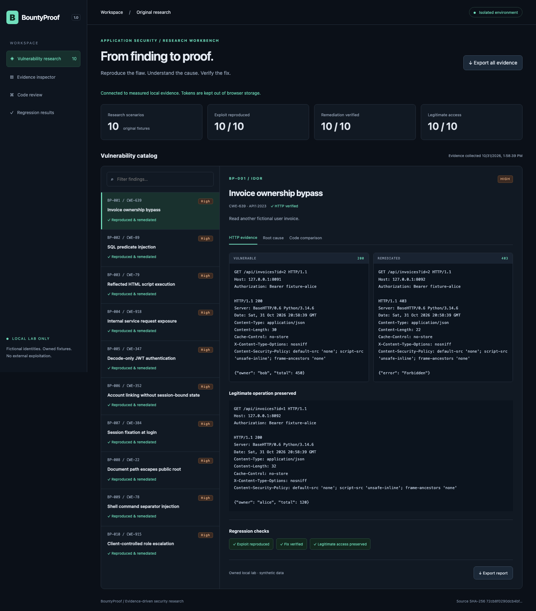

# BountyProof

[](https://github.com/jayekwere/bountyproof/actions/workflows/verify.yml)
[](LICENSE)

**Reproduce the flaw. Explain the cause. Prove the fix.**

An original application security research platform with ten intentionally vulnerable and corrected Python fixtures, bounded Python and TypeScript replay tools, an authenticated read-only management API, and a research dashboard. Each finding connects real local HTTP evidence to source code, root cause, impact and regression results.



> Intentionally vulnerable educational software. Use a trusted isolated workstation, fictional data and loopback listeners only. Never deploy the lab to a public host, tunnel it, or use these tools against third parties.

## Quick start

Requires Python 3.12+ and Node 24.13+ or 26. Pinned dependencies require network access during installation; the core runtime and demonstrations then work offline.

```sh
npm ci --ignore-scripts
npm run verify
npm run evidence
npm start
```

Open [http://127.0.0.1:8090](http://127.0.0.1:8090). Paste the ephemeral management token printed by `npm start`. It is kept out of browser storage and regenerated at every dashboard restart. The dashboard reads verified evidence; it does not execute exploits or launch processes. Export each finding as Markdown or download the complete JSON evidence bundle.

In a separate terminal, start the owned fixtures and replay a finding:

```sh
npm run lab
# In another terminal:
python3 -m tools.replay --mode vulnerable
python3 -m tools.replay --mode fixed
node dist/src/cli.js vulnerable idor
node dist/src/cli.js fixed idor
```

The TypeScript CLI accepts the ten catalog slugs below and replays their recorded attack inputs against the two fixed local ports. It performs a single request, not the stateful verification lifecycle. Python's evidence suite performs the stateful OAuth/session tests, positive cases and remediation assertions. Stop the running lab before running test/evidence/browser suites because they own the same ports. Tools fail if those ports are occupied rather than reusing an unknown target.

## Ten implemented scenarios

| ID | Slug | Demonstrated flaw | Fixed behavior |
| --- | --- | --- | --- |
| BP-001 | idor | Alice reads Bob's invoice | Ownership check returns 403; Bob still reads it |
| BP-002 | sql | Input broadens a SQLite predicate | Bound parameters prevent cross-user results |
| BP-003 | xss | Reflected script sets a browser marker | Context-aware HTML escaping renders text |
| BP-004 | ssrf | Backend exposes private fixture resource | Exact approved destination check returns 403 |
| BP-005 | jwt | Unsigned token impersonates Bob | Signature, algorithm, expiry, issuer and audience enforced |
| BP-006 | oauth | Unsolicited account-link callback | Session-bound, expiring, single-use state enforced |
| BP-007 | auth | Login promotes a known session ID | Rotate session ID and invalidate old session |
| BP-008 | path | Traversal reads private fixture file | Resolved path containment enforced |
| BP-009 | command | Shell separator executes second printf | Argument array with shell disabled |
| BP-010 | business | Profile input sets admin role | Server rejects unauthorized role changes |

The findings are educational local discoveries, with contextual High severity rather than externally validated CVSS scores. [Individual reports](reports/) include requests, responses, vulnerable/fixed code, CWE, versioned OWASP mapping, impact, regression results and limitations. SQL, XSS, session, path and command mappings use OWASP Top 10 **2021**, explicitly as a historical taxonomy; API mappings use **2023**.

## Standout access-control demonstration

The same Alice bearer request, `GET /api/invoices?id=2`, produces **200 with Bob's invoice before remediation** and **403 after remediation**. The fixed implementation checks `record['owner'] != actor` on the server. Alice can still read invoice 1, Bob can still read invoice 2, anonymous requests receive 401 and nonexistent objects receive 404. See [the report](reports/BP-001-idor.md), [raw evidence](evidence/results.json) and [regression suite](tests/test_idor.py).

## Docker

```sh
docker compose up -d --build --wait
# Management token is printed by this service:
docker compose logs dashboard
# Explicitly enable the intentionally vulnerable and fixed lab:
docker compose --profile lab up -d --build --wait
python3 -m tools.docker_verify
docker compose --profile lab down
```

Default Compose starts only the dashboard and its fixed upstream gateway. The `lab` profile adds separate vulnerable and fixed containers and gateways. Only gateways publish ports, all on 127.0.0.1. Lab and management containers have internal-only networks; lab containers have no default route. Each gateway has one immutable destination. Containers run as UID 10001 with read-only roots, dropped capabilities, no new privileges, CPU/memory/PID limits and no Docker socket or host mounts. The SSRF upstream is private loopback inside each lab container. Docker Engine 28+ is required for current loopback publishing protections. Base images are pinned by digest. See [operations](docs/OPERATIONS.md).

## Verification and security review

```sh
npm run verify                  # TypeScript build/tests plus Python HTTP/security tests
npm run evidence                # actual HTTP captures plus ten Markdown reports
npx playwright install chromium # once per workstation
npm run test:browser             # actual Chromium XSS, API boundaries, UI, exports, screenshots
python3 -m venv .scanner
.scanner/bin/python -m pip install --require-hashes -r requirements-scanner.lock
python3 -m tools.sast --semgrep .scanner/bin/semgrep
npm audit --audit-level=high
```

CI runs those gates and Docker verification, then saves evidence as an artifact. There is no deployment job. Semgrep must find the three reviewed SQL, raw HTML and shell sinks inside their named vulnerable functions. Any missing control, scanner error or unreviewed result fails the gate. These local syntax rules are deliberately narrow; passing them is not a general clean security assessment. [Validation details](docs/VALIDATION.md) distinguish measured results from limitations.

## Design and learning references

- [Architecture and trust boundaries](docs/ARCHITECTURE.md)
- [Threat model](docs/THREAT_MODEL.md)
- [Burp Community and Academy workflow](docs/BURP_AND_ACADEMY.md)
- [Report template](docs/REPORT_TEMPLATE.md)
- [Security policy](SECURITY.md), [contributing](CONTRIBUTING.md), [MIT license](LICENSE)

[PortSwigger Web Security Academy](https://portswigger.net/web-security/all-labs) supplies public learning references only. No proprietary training content or copied lab solutions are included. No Academy completion is claimed and no account integration or credentials are needed.

ReviewShield (inspected at commit `60d71b9a5a19ed50de8a01a7b7ccbebe250c9fe3`) normalizes static scanner evidence and publishes review checks. PrivilegePath analyzes authorization graphs. BountyProof instead executes original application flaws and validates remediation through HTTP and browser behavior. Its findings are not fabricated bounty submissions or third-party disclosures.
