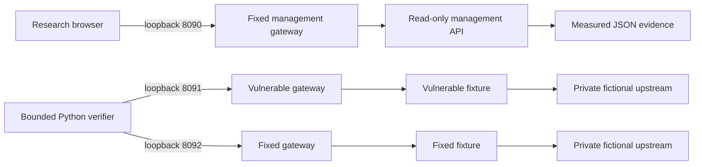

# Architecture

The management plane is a TypeScript Node HTTP server on 8090 serving a static browser application and a token-protected evidence API. It has no scanner, shell, write, report-upload or target-selection endpoint. The user starts verification locally. JSON artifacts and screenshots provide reviewable results without making the dashboard an exploitation service.

For native runs the three fixture listeners bind loopback; no gateways are needed. The verifier creates its own listeners, captures real HTTP requests/responses, asserts malicious and legitimate behavior, shuts down listeners and records source SHA-256 plus UTC collection time. It fails on occupied ports. Stateful OAuth and session tests run within a process-owned fresh fixture instance. Data lives in memory and is discarded on restart. SQLite databases are per-request and explicitly closed.

In Compose, vulnerable and fixed modes are separate containers on separate internal networks. The management container has its own internal network and no lab connection. Docker cannot publish a listener attached exclusively to an internal network on the tested engine. Therefore small gateways provide fixed upstream forwarding from separate ingress networks. A gateway cannot select an arbitrary host or port from request data. The lab containers have no default route. Gateways are infrastructure, not vulnerable research endpoints, and never execute user commands.

The SSRF transport cage permits exactly two local upstream URLs with redirects and proxies disabled. The vulnerable application skips authorization between public and private resources; fixed mode allows only the public resource. Command injection accepts only `hello` and `hello; printf INJECTED`; the vulnerable function really invokes a shell and the corrected function passes an argument vector. Path traversal accepts only a public file and a fictional private marker; the corrected implementation independently checks resolved containment.

The catalog supplies metadata and original research notes. `lab/scenarios.py` contains explicitly named vulnerable/fixed implementations except IDOR, which shares an explicit mode-dependent ownership check. The verifier extracts their actual code into the evidence bundle. Python exports ten Markdown reports; browser export builds a report from the same measured data. The source hash covers `lab/scenarios.py`, not a signed release or the entire checkout. Anyone with write access to the checkout can replace evidence; this is a local research artifact, not an attestation service.

Production dashboard code uses Node built-ins and has no runtime npm dependencies. Python fixture/runtime uses the standard library. Development dependencies and scanner dependencies are locked separately. CI has read-only repository permissions and no publishing or deployment credentials.

Business roles persist per fictional actor in process memory. The vulnerable profile update grants the submitted administrator role; the fixed update rejects it. A separate administrator-only audit endpoint checks the stored server-side role, making the before/after privilege impact observable through a second request.
